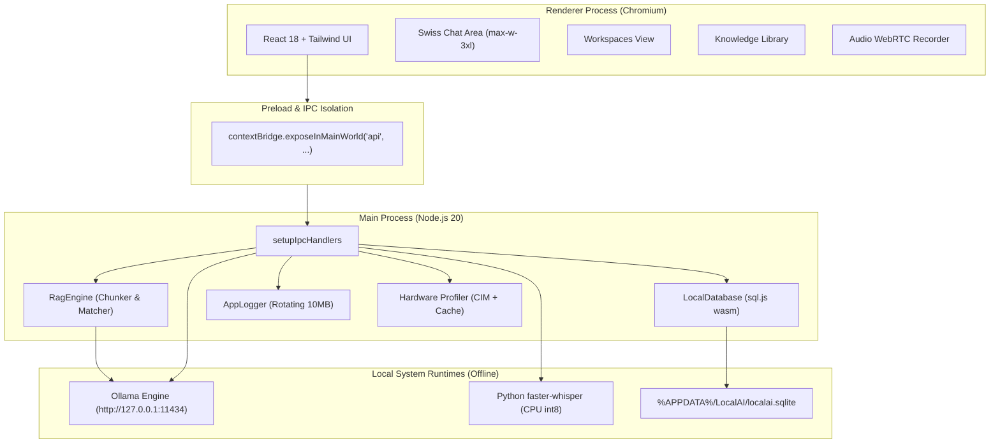

# LocalAI — System Architecture & Data Model

**Platform**: Windows Desktop (Electron + Node 20)  
**Security Boundary**: Strict loopback only (`127.0.0.1`)

---

## 1. System Topology



---

## 2. Data Models (SQLite Schemas)

All relational data is persisted in `%APPDATA%/LocalAI/localai.sqlite`.

### Workspace Table
```sql
CREATE TABLE IF NOT EXISTS workspaces (
  id TEXT PRIMARY KEY,
  name TEXT NOT NULL,
  instructions TEXT DEFAULT '',
  color TEXT DEFAULT '#2563EB',
  memory TEXT DEFAULT '',
  created_at INTEGER NOT NULL,
  updated_at INTEGER NOT NULL
);
```

### Conversations Table
```sql
CREATE TABLE IF NOT EXISTS conversations (
  id TEXT PRIMARY KEY,
  title TEXT NOT NULL,
  created_at INTEGER NOT NULL,
  updated_at INTEGER NOT NULL,
  pinned INTEGER DEFAULT 0,
  temperature REAL DEFAULT 0.7,
  context_length INTEGER DEFAULT 4096,
  max_tokens INTEGER DEFAULT 2048,
  model TEXT DEFAULT 'qwen3:4b',
  workspace_id TEXT,
  FOREIGN KEY (workspace_id) REFERENCES workspaces(id) ON DELETE SET NULL
);
```

### Messages Table
```sql
CREATE TABLE IF NOT EXISTS messages (
  id TEXT PRIMARY KEY,
  conversation_id TEXT NOT NULL,
  role TEXT NOT NULL,
  content TEXT NOT NULL,
  created_at INTEGER NOT NULL,
  tokens_per_sec REAL,
  total_duration_ms REAL,
  citations TEXT,
  images TEXT,
  FOREIGN KEY (conversation_id) REFERENCES conversations(id) ON DELETE CASCADE
);
```

### Documents Table (Knowledge Library)
```sql
CREATE TABLE IF NOT EXISTS documents (
  id TEXT PRIMARY KEY,
  filename TEXT NOT NULL,
  filepath TEXT NOT NULL,
  file_type TEXT NOT NULL,
  file_size INTEGER NOT NULL,
  file_hash TEXT NOT NULL,
  scope TEXT DEFAULT 'global',
  created_at INTEGER NOT NULL,
  updated_at INTEGER NOT NULL
);
```

### Document Chunks & Embeddings Table
```sql
CREATE TABLE IF NOT EXISTS document_chunks (
  id TEXT PRIMARY KEY,
  document_id TEXT NOT NULL,
  chunk_index INTEGER NOT NULL,
  page_or_section TEXT,
  content TEXT NOT NULL,
  embedding TEXT NOT NULL,
  scope TEXT DEFAULT 'global',
  FOREIGN KEY (document_id) REFERENCES documents(id) ON DELETE CASCADE
);
```

### Settings Table
```sql
CREATE TABLE IF NOT EXISTS settings (
  key TEXT PRIMARY KEY,
  value TEXT NOT NULL
);
```

---

## 3. API Surface & Network Boundary

### Permitted Loopback Endpoints
The Electron session layer enforces an interceptor (`onBeforeRequest`) permitting only loopback URLs:
- `http://127.0.0.1:11434/api/tags` (Health & model listing)
- `http://127.0.0.1:11434/api/chat` (Streaming chat inference)
- `http://127.0.0.1:11434/api/generate` (Model warmup & completions)
- `http://127.0.0.1:11434/api/embeddings` (Vector embeddings generation)
- `http://127.0.0.1:11434/api/pull` (Local model downloading)
- `http://127.0.0.1:11434/api/delete` (Local model removal)

### Blocked Endpoints
Any outbound network connection to external IP addresses or domains is blocked immediately and logged to `%APPDATA%/LocalAI/logs/app.log`.

---

## 4. File Storage Layout

All application state is kept inside a single dedicated Windows AppData directory:
```
%APPDATA%/LocalAI/
├── localai.sqlite          # Primary SQLite database (chats, workspaces, documents, embeddings)
├── localai.sqlite.bak      # Automated safety backup before migrations
└── logs/
    ├── app.log             # Application, IPC, and child process stdout/stderr (rotated at 10MB)
    ├── app.log.<ts>.old    # Rotated archive log
    └── startup.log         # Instrumentation milestones (t0 -> t4 latency tracking)
```

---

## 5. UI/UX Design Brief (Minimalism + Swiss + Bento)

- **Reading Column**: Centered conversation column constrained to `max-w-3xl` (~768px) with generous whitespace and clear vertical hierarchy.
- **Color Tokens**:
  - Light Background: `#F8F9FA` | Border: `#E5E7EB` | Card: `#FFFFFF`
  - Dark Background: `#0F1012` | Border: `#222429` | Card: `#16181D`
  - Single Accent: Neutral Swiss Blue (`#2563EB`)
- **Typography**: Clean sans-serif system stack (`Inter`, `-apple-system`, `Segoe UI`) with monospace font for tokens/sec, code blocks, and model tags.
- **Bento Grid**: Structured rectangular modular cards for system specs, workspaces, and settings with consistent 8px/12px padding.
- **Rejected Aesthetics**: Purple gradients, glassmorphism blur, neumorphism, cyberpunk neon, floating emoji clutter.

