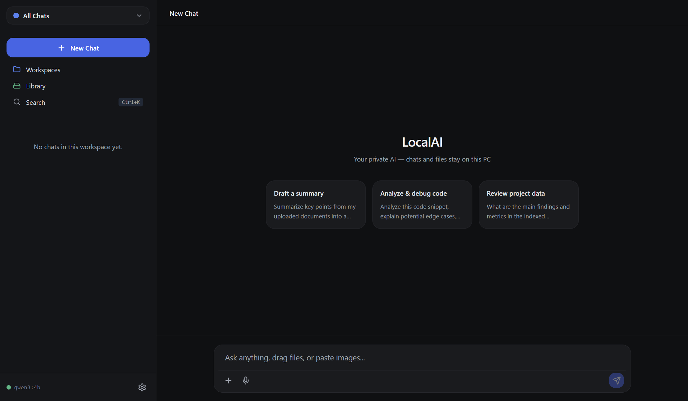
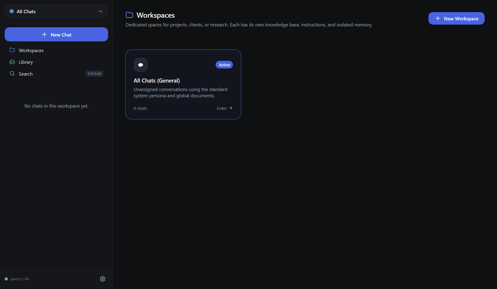
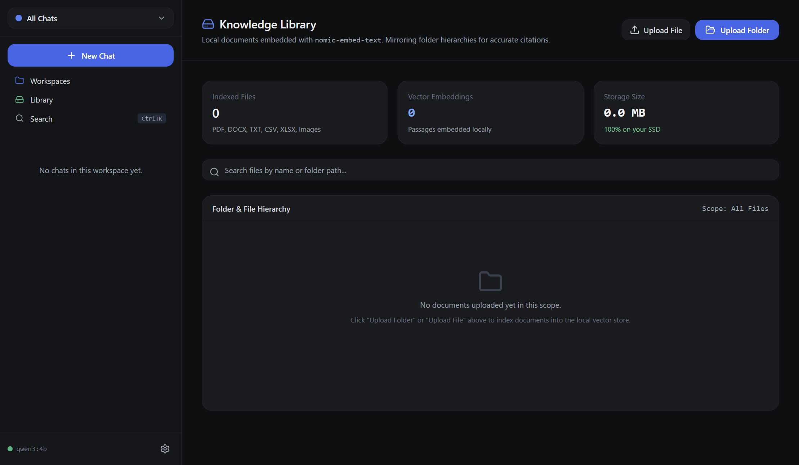

# LocalAI

> A private, offline desktop AI assistant for Windows.  
> Powered by Ollama (`http://127.0.0.1:11434`), SQLite, local vector RAG, and offline faster-whisper.  
> All prompts, documents, images, voice audio, and weights stay 100% on this PC.

---

## What It Does
- **Private Chat**: Local conversational LLM streaming with token/sec speed indicators, Markdown formatting, and syntax-highlighted code blocks.
- **Local RAG & File Ingestion**: Drag-and-drop or select PDF, DOCX, TXT, MD, CSV, XLSX, and images. Uses `nomic-embed-text` embeddings with cosine similarity and source-level citations.
- **Folder Sync**: Recursively scan directories with differential checksum sync (0 duplicate re-indexing).
- **Workspaces**: ChatGPT/Claude-style project containers with isolated system instructions, custom memory, and scoped document libraries.
- **Offline Voice-to-Text**: Local speech transcription via `faster-whisper` (CPU int8) running offline.
- **Multimodal Vision**: OCR, chart analysis, and image understanding via local vision models (e.g. `qwen3.5:4b`).
- **Hardware-Aware Tiering**: Automatic hardware detection to recommend optimal model sizes (8GB entry, 16GB default, 32GB high performance).

## What It Does NOT Do
- **Zero Cloud APIs**: No OpenAI, Anthropic, Google, or third-party cloud LLM endpoints.
- **Zero Telemetry**: No analytics, tracking pixels, usage reporting, or remote phone-home pings.
- **Zero Accounts**: No sign-up, login, OAuth, passwords, subscriptions, or paywalls.
- **Zero External Network Calls**: Network sandboxing blocks all outbound requests except `127.0.0.1:11434`.

---

## Screenshots

### 1. Minimalist Swiss Chat


### 2. Isolated Workspaces


### 3. Knowledge Library & Document RAG


---

## Quickstart & Installation (Windows)

### Prerequisites
1. **Ollama**: Download and install from [ollama.com](https://ollama.com).
2. **Pull Default Models**:
   ```bash
   ollama pull qwen3:4b
   ollama pull nomic-embed-text
   ```
3. **Node.js**: v20 or newer.
4. **Python** (for optional offline voice-to-text): Python 3.10+ with `faster-whisper`.

### Development Setup
```bash
# Clone the repository
git clone https://github.com/SayemKaderChowdhury/LocalAI.git
cd LocAI

# Install dependencies
npm install

# Run Vite dev server and Electron
npm run dev:electron
```

### Build & Package for Windows
```bash
# Compile renderer and Electron main process
npm run build

# Package unpacked Windows directory executable
npm run package
# Output executable: release/win-unpacked/LocalAI.exe
```

---

## Documentation Index
- [Architecture & Data Flow](docs/ARCHITECTURE.md)
- [Project Requirements & Scope](docs/PRD.md)
- [System Essentials & Guardrails](docs/ESSENTIALS.md)
- [Engineering Discipline & Claude Guide](docs/CLAUDE.md)
- [Design Tokens & UI System](docs/DESIGN.md)
- [Tickets & Acceptance Ledgers](docs/TICKETS.md)
- [Session History](docs/SESSION.md)
- [Startup Timeline & Latency Benchmark](docs/startup-timeline.md)
- [Terminal & Process Audit](docs/terminal-audit.md)
- [Framework Decision Assessment](docs/framework-decision.md)
- [Changelog](CHANGELOG.md)

---

## License
MIT License. See [LICENSE](LICENSE) for details.

